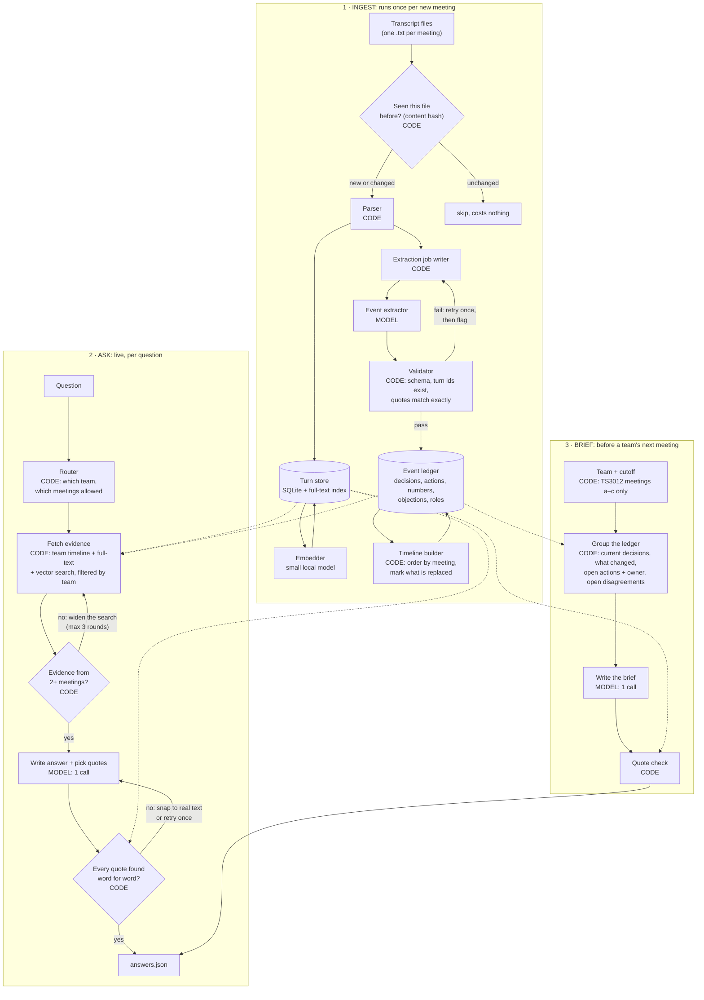

# Architecture

The short version: **meetings are read and turned into memory once. Questions are answered from
that memory.** Code does every step that has one right answer. A model only does the steps that
need language understanding.

## 1. Three ways to run it

All three use the same pipeline and code. Only the model behind each step changes.

| | A. Best quality | B. Cost-effective (what we recommend to Catalist) | C. This build ($0) |
|---|---|---|---|
| **Pull events out of meetings** | Claude Sonnet 5.5, Batch API | Claude Haiku 5.5, Batch API | Claude Code fills extraction jobs (subscription, no API spend) |
| **Answer questions** | Sonnet 5.5, agent loop with several searches | Haiku 5.5. Hard questions escalate to Sonnet 5.5 | Free-tier API model, with a local fallback model |
| **Search** | Postgres + pgvector + full-text | SQLite or Postgres full-text + small embeddings | SQLite full-text (FTS5) + local embeddings via Ollama |
| **Cost to ingest 1,000 meetings** | ~$15 batched (~$30 standard) | **~$0.75 batched (~$1.50 standard)** | $0 |
| **Cost per question** | ~$0.10 to $0.15 | ~$0.002 to $0.01 | $0 |
| **When to choose it** | Legal or board-level accuracy matters | Daily use by a whole company | Demo and evaluation |

How the 1,000-meeting figure is worked out: the corpus averages ~4,900 words (~6,400 tokens) per
meeting. Adding prompt instructions gives ~7.5M input tokens; extracted events add ~1.5M output
tokens. List prices (per million tokens): Haiku 5.5 $0.10 in / $0.50 out, Sonnet 5.5 $2 / $10,
with 50% off for batch. Recheck the prices before quoting them.

**Demo day:** Catalist runs new questions against the corpus we already extracted. So only the
answering path has to work live. Extraction does not run during the demo.

## 2. The diagram

## 3. Each box, in plain English

### Ingest (once per meeting)
1. **Seen this file before?** Every file gets a fingerprint (a hash). If the fingerprint is
   already stored, the file is skipped. A new meeting costs one extraction; old meetings cost nothing.
2. **Parser (code).** Splits a transcript into turns: who spoke, when, and the exact words.
   Each turn gets an id like `TS3012c#0042`. The words are never changed, because quotes are checked word for word.
3. **Turn store (code).** Stores every turn in SQLite with a full-text index (keyword search).
   An embedder adds a vector for each chunk of turns (meaning-based search, so "battery" also finds "power source").
4. **Event extractor (model).** Reads one meeting and lists what happened: decisions, proposals,
   action items and their owners, prices and numbers, objections, and who holds which role. Every
   event points at the turn ids it came from.
5. **Validator (code).** Rejects any event that does not fit the format, points at a turn that
   does not exist, or quotes text that is not in that turn. This is where model mistakes get
   caught before they reach memory.
6. **Timeline builder (code).** Sorts each team's events by meeting (a, b, c, d). When a later
   decision covers the same topic, the earlier one is marked "replaced by". This is how the
   system knows what is current, and it is a rule, not a guess.

### Ask (live)
7. **Router (code).** Finds the team the question names and limits the search to that team's
   meetings. At 10,000 meetings, a question still only searches about 4 meetings.
8. **Fetch evidence (code).** Pulls the team's timeline for the topic, plus the best-matching turns
   from keyword and vector search.
9. **Enough evidence? (code).** Every question needs at least 2 meetings. If the evidence covers
   fewer, the agent widens the search and tries again, up to 3 rounds. This is the agent loop.
10. **Write answer (model, 1 call).** Writes 1 to 3 sentences and picks quotes by turn id.
11. **Quote check (code).** Confirms each quote appears word for word in that turn (case and
    spacing ignored, as the grader does). If one fails, code snaps it to the real text or the
    model gets one retry. No unchecked quote reaches `answers.json`.

### Brief (before a meeting)
12. **Cutoff (code).** For TS3012 only meetings a to c are used. Meeting d is the meeting being
    prepared for, so reading it would leak the future.
13. **Group the ledger (code).** Current decisions, what changed (from the "replaced by" links),
    open actions and owners, and objections never resolved.
14. **Write the brief (model, 1 call) and quote check (code).**

## 4. Why it holds up at 10,000 meetings
- **Ingestion cost grows with new meetings only.** The fingerprint check skips everything already done.
- **Question cost stays flat.** Every question is filtered to one team or project before searching.
- **Storage swap, not a redesign.** SQLite becomes Postgres + pgvector. The tables and code stay the same.
- **The model can be swapped.** Extraction and answering go through one interface, so A, B and C are a config change.
- **Raw turns are kept.** If the extraction prompt improves, re-run extraction. Nothing is lost.

## 5. Model vs code: the line and why
| Code (never touches a model) | Why |
|---|---|
| Parsing, ids, fingerprints | The format is fixed. A model could only alter words we must quote exactly. |
| Team filter, meeting cutoff | Leaking meeting d or another team must be impossible, not unlikely. |
| Meeting order, "replaced by" | Order is a fact in the file name. A model could get it wrong. |
| Quote check, JSON shape | Graded by a machine, so checked by a machine. |

| Model | Why |
|---|---|
| Event extraction | Real speech is messy: "yeah let's go with the um the rubber one". Rules cannot parse that. |
| Answer and brief writing | Turning evidence into 2 clear sentences is a language task. |
